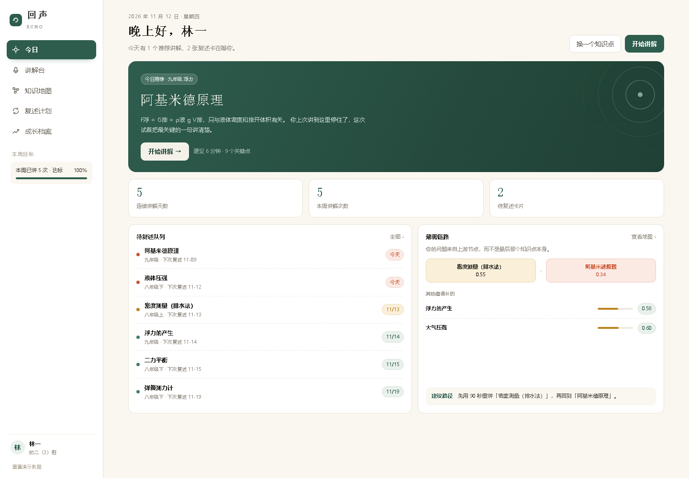
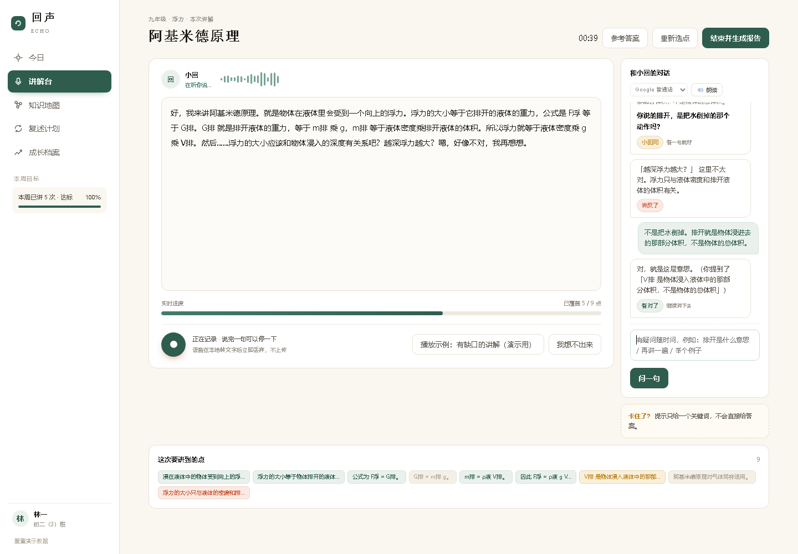
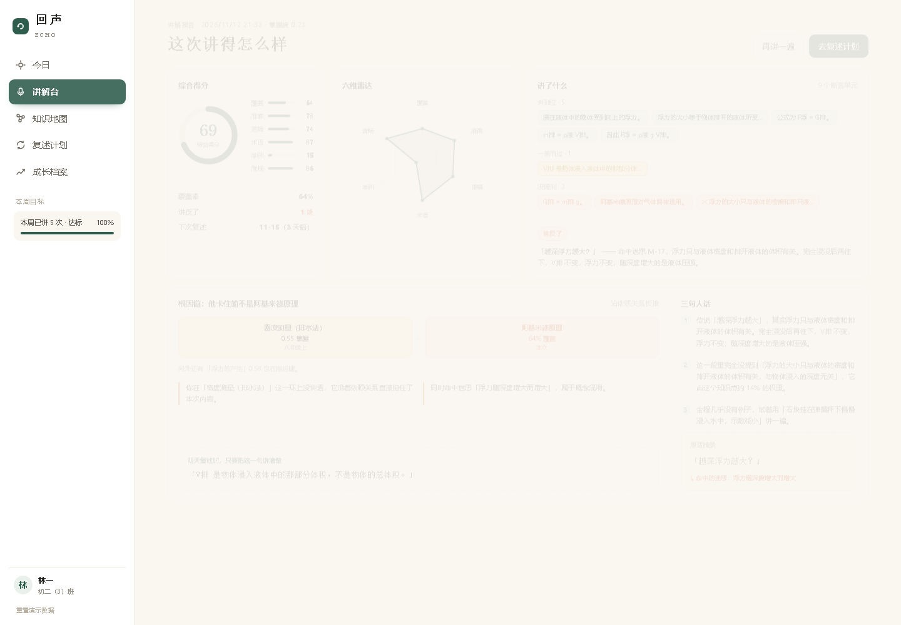
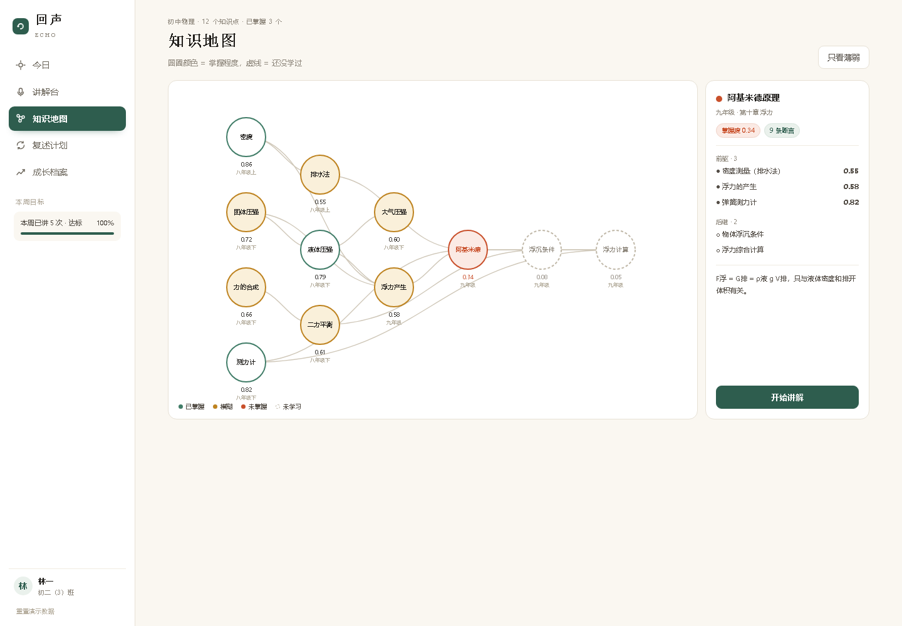
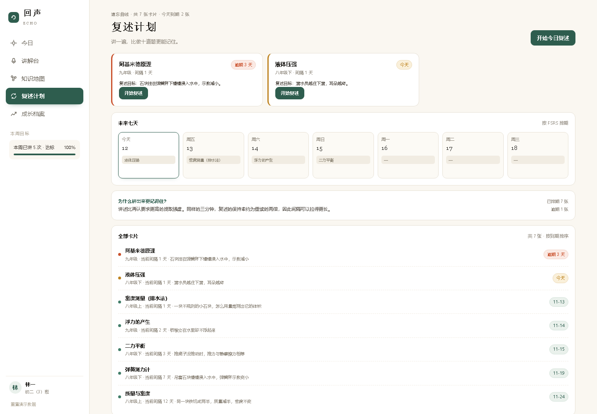
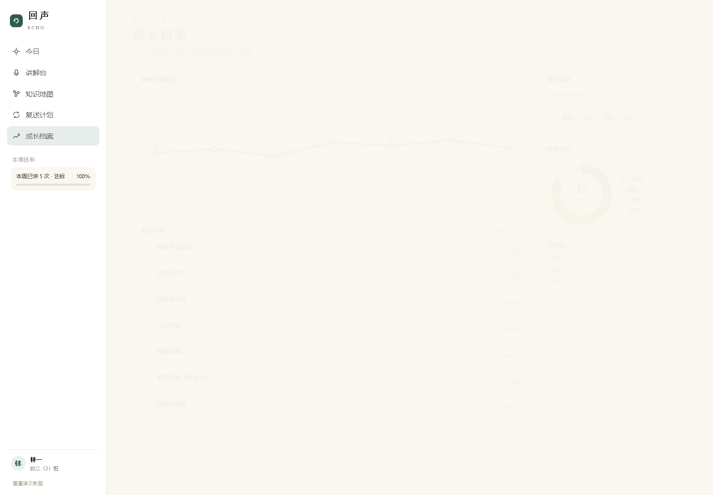

# 回声 Echo · 会追问的 AI 小先生

面向初中物理的**讲述式认知诊断**系统。学生用口语讲解一个知识点，AI 扮演一个学不懂的同桌，
在含糊的地方举手追问；讲完给出一份可解释的《讲解体检报告》——不仅指出哪里没讲清楚，
还沿知识图谱反推「这个漏洞是从八年级哪一节留下的」。

> 把 `做题 — 判题 — 推题` 的循环，换成 `讲述 — 追问 — 溯源 — 复述` 的循环。



## 界面

| 讲解台 | 体检报告 |
|---|---|
|  |  |

| 知识地图 | 复述计划 | 成长档案 |
|---|---|---|
|  |  |  |

---

## 一键启动

**双击 start.bat** 即可：自动挑一个能用的 Python → 起服务 → 用 Edge 打开 <http://127.0.0.1:8771>。
停止服务双击 stop.bat。

手动方式：


```bash
# 1. 安装依赖（PyPI 慢的话加国内镜像）
pip install -r requirements.txt -i https://pypi.tuna.tsinghua.edu.cn/simple

# 2. 启动
python run.py

# 3. 打开
#    http://127.0.0.1:8771
```

零依赖说明：**诊断引擎本身只用 Python 标准库**（图算法、匈牙利匹配、BKT、FSRS 全部手写），
`fastapi/uvicorn` 只用于对外提供 HTTP 接口，`jieba` 缺失时会自动退回字符二元组分词。

---

## 目录结构

```
应用/
├─ run.py              启动入口（检查依赖 → 起服务）
├─ server.py           REST API（FastAPI）
├─ engine/             诊断引擎（标准库实现）
│  ├─ text.py          规范化、分句、同义词、关键词命中
│  ├─ segment.py       分词（jieba 可选）
│  ├─ matcher.py       覆盖匹配（字符 n-gram + 匈牙利算法）
│  ├─ graph.py         知识图谱：前驱闭包、路径枚举、拓扑序
│  ├─ bkt.py           贝叶斯知识追踪
│  ├─ probe.py         苏格拉底追问（信息增益选探针）
│  ├─ srs.py           记忆调度（FSRS-4.5 简化）
│  ├─ diagnose.py      诊断主流程
│  └─ store.py         SQLite 存储
├─ data/
│  ├─ curriculum.json  知识库：12 节点 / 15 边 / 61 断言 / 20 迷思 / 24 探针
│  ├─ samples.json     演示用讲解样例
│  └─ validate.py      知识库校验（环检测、引用一致性）
└─ web/                前端（原生 HTML/CSS/JS，无构建）
```

---

## 算法流水线

| 阶段 | 做什么 | 用什么 |
|---|---|---|
| ① 切分 | 按句末标点分句，长句再按逗号切子句 | 规则 |
| ② 覆盖 | 句子 × 断言 的最大权二分匹配 | 字符二元组 Dice + 关键词组，**匈牙利算法** |
| ③ 迷思 | 触发词三路判定（命中 / 排除词 / 冲突断言） | 迷思库 |
| ④ 溯源 | 沿 DAG 前驱闭包反推根因 | **BKT** + 带衰减的路径权重 |
| ⑤ 追问 | 选信息量最大的探针 | 二元熵 × 断言权重 |
| ⑥ 调度 | 生成下次复述时间 | **FSRS-4.5** |

根因得分：

```
R(u) = (1 − P(L_u)) × Σ_{p ∈ Path(u→k)} γ^{len(p)} · w(p)      γ = 0.75
```

---

## 知识库

12 个知识点，覆盖八年级上至九年级浮力章节：

```
质量与密度 ──→ 密度测量（排水法） ──┐
                                  ├──→ 阿基米德原理 ──→ 物体浮沉条件 ──→ 浮力综合计算
固体压强 ──→ 液体压强 ──→ 浮力的产生 ┘         ↑
                    └──→ 大气压强        二力平衡 ─────────┘
弹簧测力计 ─────────────────────────────┘
```

- 断言单元 61 条，每条带权重与关键词组
- 迷思库 20 条，每条带触发词、排除词、**对应冲突断言**
- 探针库 24 个，每个绑定到具体断言

校验：`python data/validate.py`（会检查环、引用、孤立节点）

---

## 接口

| 方法 | 路径 | 说明 |
|---|---|---|
| GET | `/api/bootstrap` | 首页：今日推荐、统计、待复述、薄弱链路 |
| GET | `/api/graph` | 图谱（含掌握度与状态） |
| GET | `/api/node/{id}` | 知识点详情 |
| POST | `/api/session/start` | 开始讲解 |
| POST | `/api/session/utter` | 实时转写 → 覆盖率与追问 |
| POST | `/api/session/finish` | 生成报告，更新掌握度与复述卡 |
| GET | `/api/review` | 复述队列 |
| POST | `/api/review/{card}/grade` | 复述评分 |
| GET | `/api/growth` | 成长趋势、能力标签 |
| POST | `/api/demo/reset` | 重置演示数据 |

接口文档：<http://127.0.0.1:8771/api/docs>

---

## 设计文档

- [创意设计说明书](回声Echo-创意设计说明书.docx)（18 页，含 10 张设计图）

## 许可

课程作业项目，仅供学习交流。
